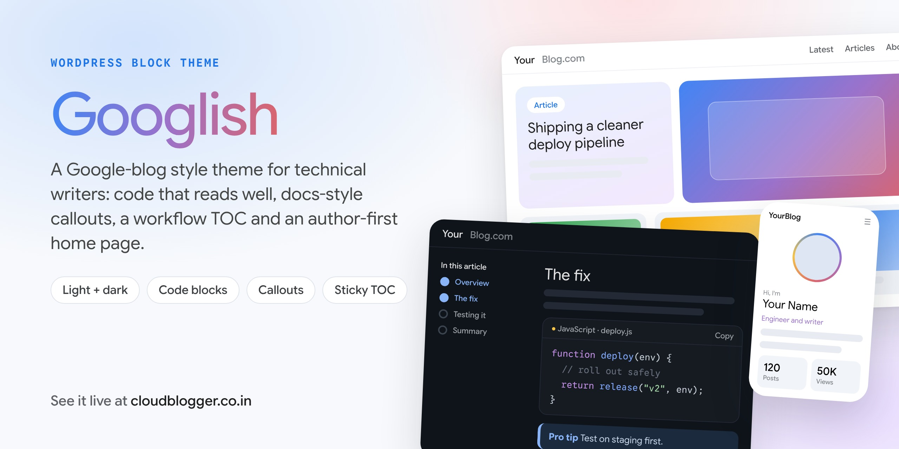
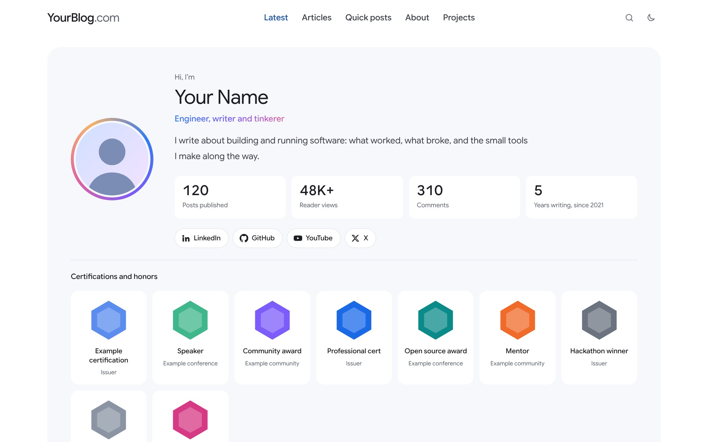
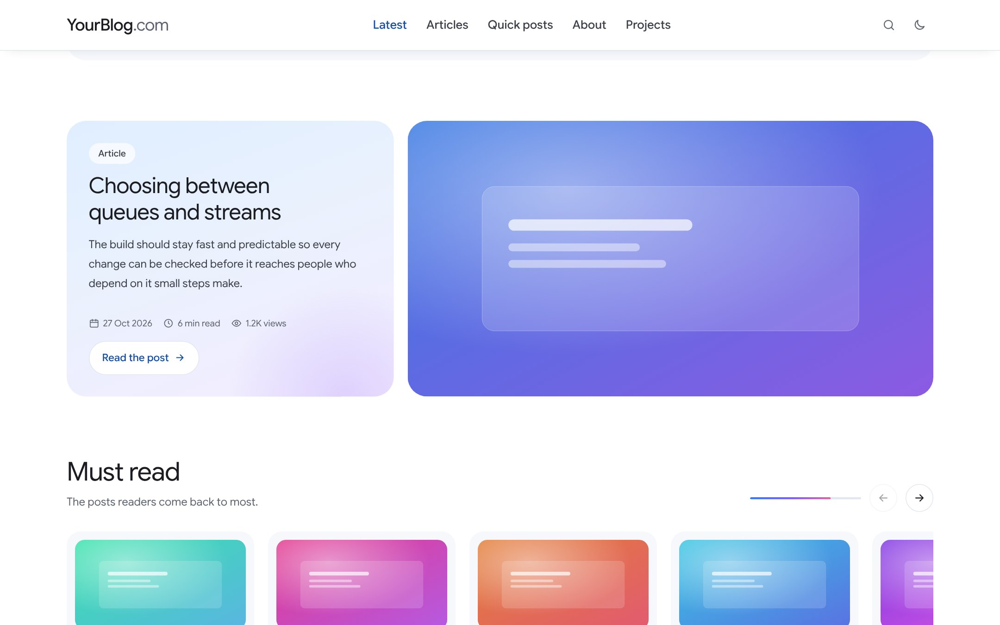
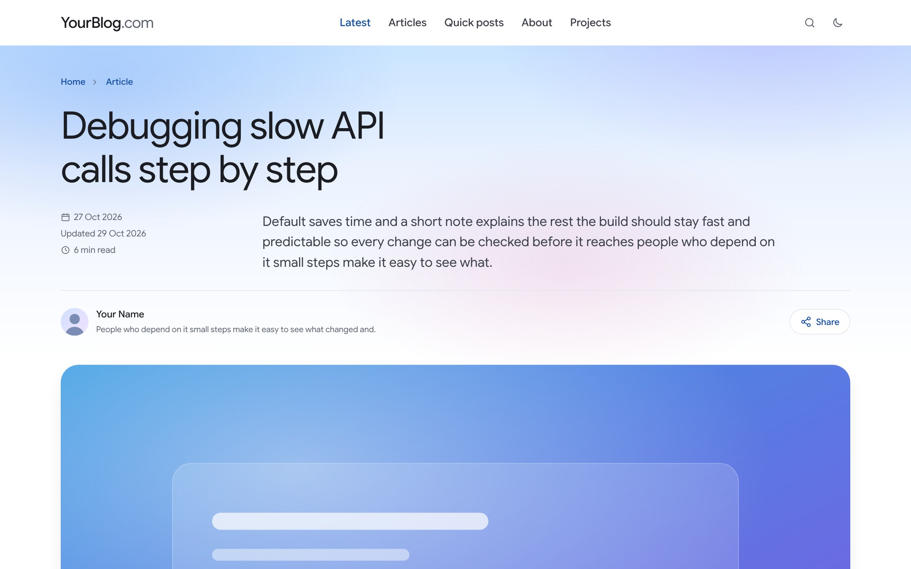
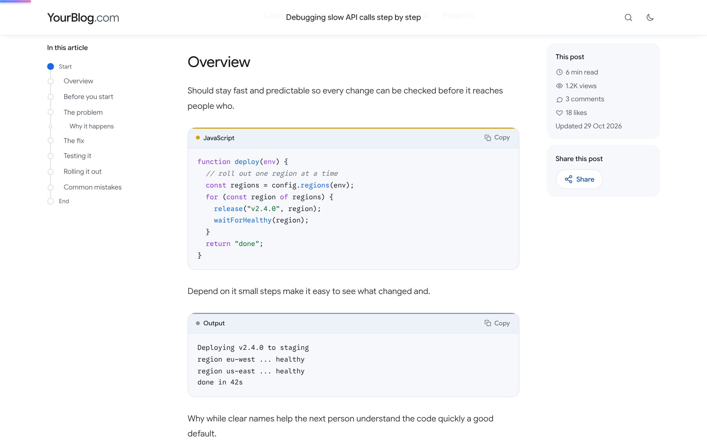
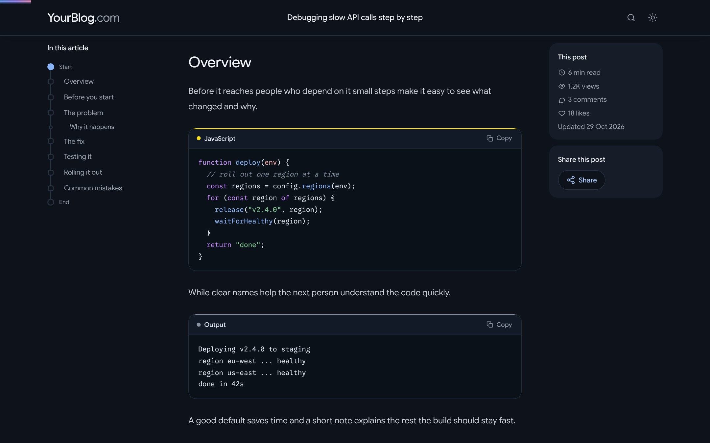
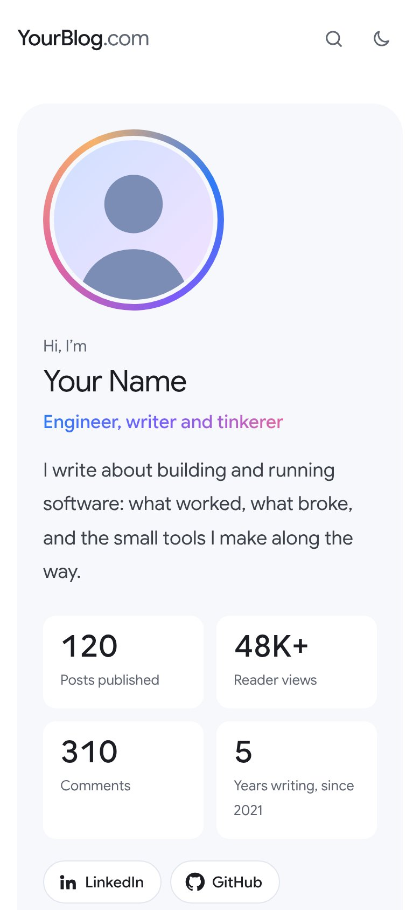

# Googlish — a Google-blog style WordPress block theme

A WordPress block theme for technical blogs, styled after Google's blogs and Google Cloud docs. Code that reads well, docs-style callouts, a workflow-style table of contents, and a home page that puts the author first.

**Live example: [cloudblogger.co.in](https://cloudblogger.co.in/)**, a blog on VCF Automation and VCF Operations Orchestrator. It runs on WordPress.com (Business plan).

**New here? Read the [setup and customisation guide](docs/GUIDE.md).**

Current version: **2.8.2**. See [CHANGELOG.md](CHANGELOG.md).

## Screenshots

Renders of the theme with sample content.

| Home: author spotlight | Home: featured story and Must read |
| --- | --- |
|  |  |

| Post: header | Post: table of contents, code and right panel |
| --- | --- |
|  |  |

| Dark mode | Phone |
| --- | --- |
|  |  |

## See it live

The theme runs [cloudblogger.co.in](https://cloudblogger.co.in/). Have a look at:

- [The home page](https://cloudblogger.co.in/): author spotlight, featured story, Must read, tools, Just in, community.
- [A post](https://cloudblogger.co.in/2026/10/27/resolving-typeerror-cannot-find-function-exec-in-orchestrator-9-1-1/): table of contents, code blocks, callouts, right panel, Like and feedback.
- Toggle dark mode with the moon icon in the top bar, and try it on your phone.

## Features

**Home page**
- Meet the author: photo, bio, live blog stats (posts, views, comments, years), social links, certifications as cards.
- Featured story as a large split card, with the next three posts as cards below it.
- Must read carousel: your sticky posts first, then the most-viewed posts of the last 90 days (Jetpack Stats).
- Tools I've built: colourful cards for your own projects.
- Just in: latest posts with topic chips and pagination.
- Community: recent conversations (commenters get a generated mascot avatar) beside a topics cloud.
- From the archive: three random older posts, different on every view.

**Posts**
- Hero band with breadcrumb, title, standfirst, date, updated date, read time and views, author and Share menu.
- "In this article" table of contents drawn as a workflow, sticky on wide screens, with reading progress.
- Right panel: this post's stats, Share this post, and "Was this helpful?" with Send feedback.
- Image viewer: click any image to enlarge, with previous/next, keyboard and swipe.
- Like button in the theme's style; its count includes existing WordPress.com likes.
- More from the blog: three random posts, different on every view.
- "Post without table of contents" template for short posts.

**Code**
- Header with language label, file name, Copy button; line numbers from 4 lines; "Show all" for long scripts.
- Syntax highlighting with highlight.js (bundled), per-language accent colours, light and dark token colours.
- Language detected automatically, or set it with CSS classes on the Code block: `lang-javascript file-getVmByName.js`, `lang-output`, `no-lines`.
- Code Block Pro blocks are converted to the same style (add class `cb-keep-cbp` to opt out).
- Tabs for "same task, different tools" (like Console / gcloud / API in Google Cloud docs).

**Writing**
- Callouts as block styles on Paragraph and Group: Note, Pro tip, Important, Caution, Warning.
- Patterns: before you begin, what's next, tested on, numbered steps, before and after, video and screenshot frames, code with file name, download from GitHub, standard post outline.

**Everywhere**
- Light and dark modes (follows the system, with a toggle).
- Google Sans Flex and Google Sans Code, bundled.
- Hamburger menu on screens under 1100px.

## Custom blocks (category: Theme)

| Block | What it does |
| --- | --- |
| `cloudblogger/post-stats` | Author, date, updated, read time, views, comments, likes — pick the items |
| `cloudblogger/site-stats` | Blog-wide posts, views, comments, years |
| `cloudblogger/must-read` | Sticky posts then most viewed (`count`, `days`) |
| `cloudblogger/random-posts` | Random post cards, re-picked on every view (`count`, `pool`, `anyAge`) |
| `cloudblogger/recent-comments` | Recent comments as cards with mascots |
| `cloudblogger/share` | Share menu: copy link, LinkedIn, X, WhatsApp, Telegram, Reddit, email |
| `cloudblogger/like` | Like button |
| `cloudblogger/feedback` | "Was this helpful?" with Send feedback |

## Install

1. Download this repository as a zip (Code → Download ZIP).
2. In WordPress: Appearance → Themes → Add New → Upload Theme, choose the zip. If the theme is already installed, choose "Replace current with uploaded".
3. Activate it.

On WordPress.com this needs a plan that allows uploading themes (Business or higher).

If a template doesn't change after an update, it has saved customisations from the Site Editor. Open Appearance → Editor → Templates, pick the template and choose Reset.

## Where feedback and likes are stored

- Yes/No votes: post meta `_cb_fb_yes` / `_cb_fb_no`, shown in a **Helpful** column in the classic Posts list (`/wp-admin/edit.php`).
- Written feedback: a private comment of type `cb_feedback`, held for moderation and never shown on the site (`/wp-admin/edit-comments.php?comment_status=moderated`). Don't approve them; trash them once read.
- Likes from the theme's button: post meta `_cb_likes`, one per visitor per post per day.

## Recommended plugins

- Jetpack (Stats for views and Must read; Likes for the existing like counts). Both are built in on WordPress.com.

## Customising for your own blog

The author block, tools, nav links and footer links ship with placeholder content ("Your Name", "yourhandle", "Project one"). Replace it in the Site Editor, or in `patterns/` and `parts/`. The [guide](docs/GUIDE.md) walks through every section.

## Credits

- Created by **Mayank Goyal** ([@imtrinity94](https://github.com/imtrinity94)).

- Google Sans Flex and Google Sans Code: Google LLC, SIL Open Font License 1.1 (`assets/fonts/OFL.txt`).
- highlight.js 11.12.0: BSD-3-Clause (`assets/vendor/highlight-LICENSE.txt`).

## License

GPLv2 or later.
